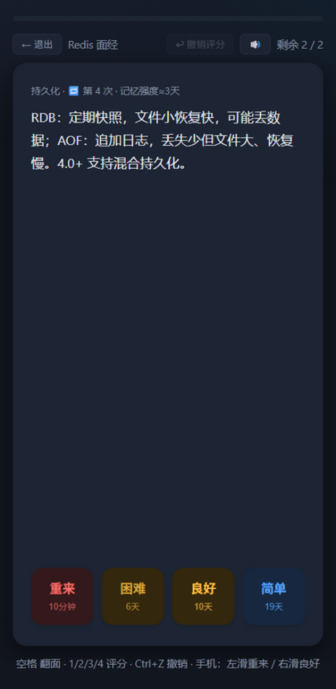
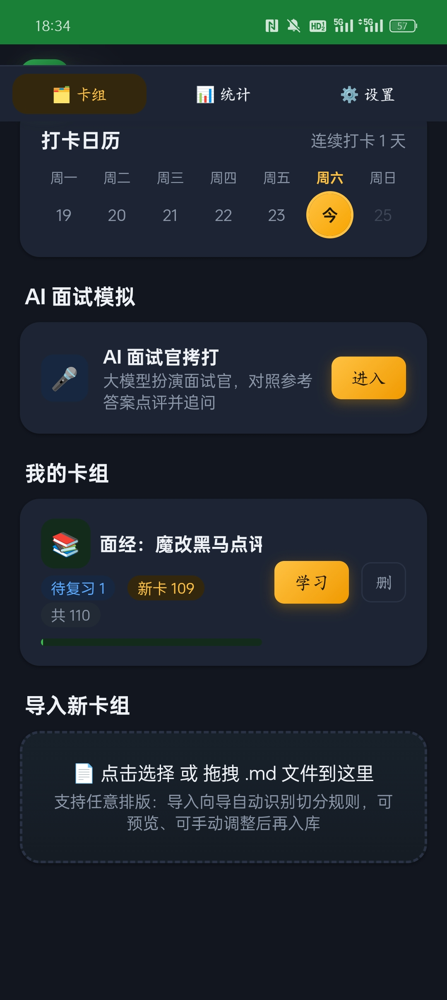
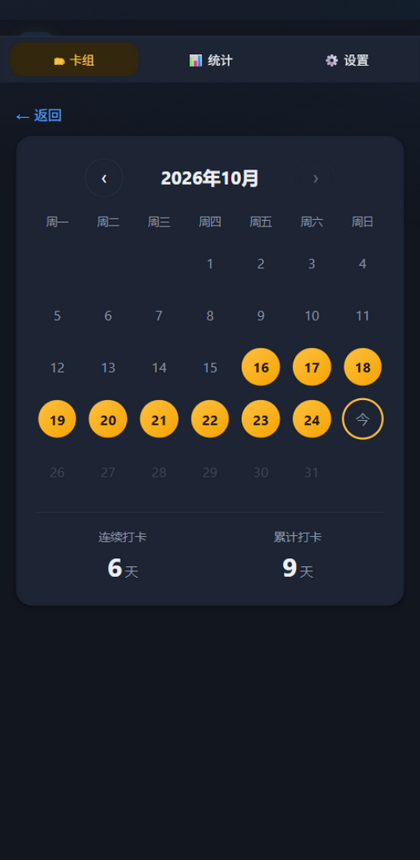
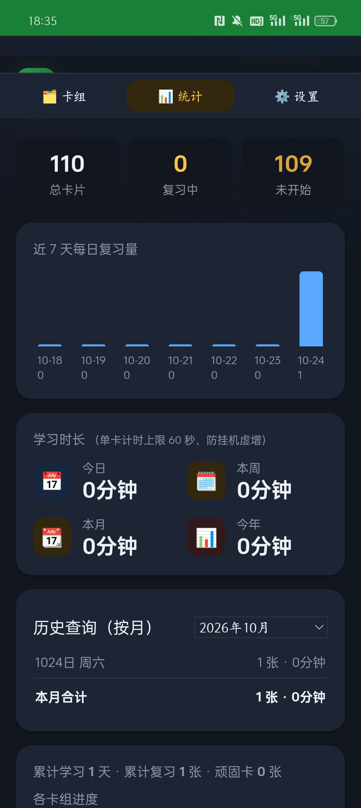
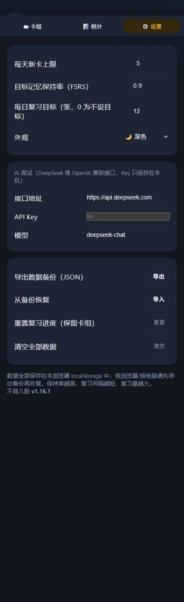

<div align="center">


# 不背八股 · ByeByeBaGu

**把你自己的 Markdown 八股/面经，变成像背单词一样的刷卡复习**

*导入 → 间隔重复 → AI 面试官拷打，一个 HTML 文件全搞定*

简体中文 | [English](README_EN.md)

[](https://nina-noschool.github.io/ByeByeBaGu/)
[](八股闪背.html)
[](deploy/一键安装指南.md)

[](LICENSE)
[](#-特性)
[](八股闪背.html)
[](#-特性)
[](deploy/一键安装指南.md)
[](https://github.com/nina-noschool/ByeByeBaGu/pulls)

</div>

---

## 为什么做它

背八股最大的痛点：**看了就忘，面试时说不出口**。
不背八股把你的面经笔记切成卡片，用 FSRS 间隔重复算法安排你"什么快忘了就什么时候再见面"，
再让大模型扮演面试官**当场拷打你**——背过，更要用嘴说过。

<div align="center">
<table>
  <tr>
    <td align="center"><br><sub>首页 · 目标与数据</sub></td>
    <td align="center"><br><sub>沉浸式刷卡 · 四键评分</sub></td>
    <td align="center"><br><sub>卡组详情 · 浏览编辑</sub></td>
  </tr>
  <tr>
    <td align="center"><br><sub>打卡日历</sub></td>
    <td align="center"><br><sub>时长统计 · 年度报告</sub></td>
    <td align="center"><br><sub>设置 · 外观与 AI</sub></td>
  </tr>
</table>
<sub>以上为 v1.16 真实界面截图</sub>
</div>

## ✨ 特性

**🌐 中英双语界面**
设置里一键切换 中文 / English（或跟随浏览器语言）；日期、间隔、时长、日历、统计全部本地化，
AI 面试官也会跟随界面语言用英文提问点评。

**📥 任意排版导入**
拖入 `.md` 文件（或直接**粘贴文本**），导入向导自动识别切分方式（标题层级 / 问答对 / 列表项 / 行内卡），
导入前可预览、可切换策略，含空答案/超长答案诊断与一键撤销。
去重按**语义键**计算——笔记调格式、改标点再导入，不会产生重复卡、不会重置进度。
解析规则见[导入规格](docs/import-spec.md)。

**🤖 AI 出题与 AI 面试官**
「AI 出题」把任意笔记一键整理成问答卡送进导入向导；
「AI 面试官拷打」接入 DeepSeek（兼容任何 OpenAI 格式接口）逐题提问：
对照参考答案点评你的回答 → 自然地追问 → 打分 → 结束出总评与补强方向。

**🧠 FSRS 间隔重复调度**
移植自 [ts-fsrs](https://github.com/open-spaced-repetition/ts-fsrs) 的最新 FSRS 公式，
目标记忆保持率可调（默认 0.9），每张卡实时显示记忆强度与下次间隔。

**🎯 弱卡优先与断点续学**
组队时按"最近 10 次评价"计算薄弱分，薄弱卡本轮自动多出现 2~3 次；
中途退出/刷新不丢进度，首页一键"继续学"。

**🃏 科学的刷卡体验**
空格翻面、四键评分（重来/困难/良好/简单，每键显示下次间隔）、评分可撤销（Ctrl+Z）、
🔊 朗读卡面（闭眼听答案）、连错 5 次自动标记顽固卡 🔥、填空卡（`==挖空==` 点击揭示）、
答案支持 markdown 图片（架构图直接进卡片）。

**📊 数据看得见**
每日目标与打卡日历、日/周/月/年学习时长、按月历史查询、累计统计，
年底还能生成一张**年度背诵报告**（复习量 / 学习天数 / 已掌握 / 最常复习的卡组）。

**📱 真·App 体验**
PWA 安装到手机主屏幕/电脑开始菜单，完全离线可用；
移动端沉浸式学习页、左右滑评分、底部 Tab 导航、跟手翻面动画。

**🔒 数据自持**
全部数据存在本机浏览器，不上传任何内容；支持 JSON 备份/恢复。

## 🚀 快速开始

| 方式 | 做法 |
|---|---|
| **在线使用**（推荐） | 打开 [https://nina-noschool.github.io/ByeByeBaGu/](https://nina-noschool.github.io/ByeByeBaGu/) → 添加到主屏幕，详见 [安装指南](deploy/一键安装指南.md) |
| **部署自己的站点** | Fork 本仓库 → 开启 GitHub Pages → 详见 [安装指南](deploy/一键安装指南.md)，更新用 Sync fork |
| **本地运行** | 下载 [`八股闪背.html`](八股闪背.html) 双击打开，零安装 |

## 📖 导入格式

向导会自动从以下形态中识别最合适的一种，也可手动指定：

| 策略 | 原文形态 | 说明 |
|---|---|---|
| 标题切卡 | `## 问题` + 正文 / `### 问题` + 正文 | 八股笔记最常见，自动识别标题层级 |
| 问答对 | `问：…` / `答：…` 或 `Q:` / `A:` | 兼容 `**问：**`、`【问题】` 等变体 |
| 列表项 | `- 问题：一句话答案` | 一行一卡 |
| 行内卡 | `问题 :: 答案` | 语法来自 obsidian-spaced-repetition |

代码块、行内代码内的 `#`、`---`、`==`、`::` 不会被误切。
`tests/` 目录附了四种排版的[示例文件](samples/)，拖进去即可体验。

<details>
<summary><b>🤖 让 AI 帮你写卡</b>（点击展开）</summary>

- **应用内**：首页「粘贴文本导入」旁的 **🤖 AI 出题** 按钮，把任意笔记粘进输入框一键生成问答卡；
- **应用外**：把[导入规格](docs/import-spec.md)整段喂给任意 AI（ChatGPT / Claude / Cursor…），
  让它把你的笔记转成可导入格式，提示词结尾加一句：
  > 输出必须严格遵守上面规格中「标题切卡」策略的格式：每张卡一行 `## 问题`，紧跟答案正文。

</details>

## 🤖 AI 面试配置

1. 到 [platform.deepseek.com](https://platform.deepseek.com) 创建 API Key（一场面试成本约几分钱）
2. 应用「设置」→ AI 面试：填入 Key（接口地址与模型已预填 `deepseek-chat`）
3. 首页「AI 面试官拷打」→ 选卡组 → 开考

Key 只保存在本机浏览器 localStorage，不上传、不经过任何第三方服务器。

## 🐦 吉祥物 · ByteBit

一只戴耳机写代码的 Q 版八哥（"八比特"，谐音"八股"），本项目唯一的官方 IP：

<p align="center"></p>

设计记录与使用规范见 [docs/bytebit.md](docs/bytebit.md)。
它会在开屏、AI 面试"思考中"、目标达成庆祝和年度报告上出场——应用图标也是它。

## 🗺 路线图

- [x] FSRS 调度、导入向导、填空卡、AI 面试官、学习时长统计、PWA、弱卡优先、断点续学、年度报告
- [ ] `.apkg` Anki 卡组导入（零依赖约束下做技术验证中）
- [ ] IndexedDB 存储（万卡级大卡组）
- [ ] 桌面端双栏布局（平板）
- [ ] ByteBit 更多姿态与空状态插画

欢迎按[导入规格](docs/import-spec.md)和[维护规则](#)提 PR——改解析器请先改规格文档、带上测试。

## 🧑‍💻 开发与测试

零依赖、零构建，改 [`八股闪背.html`](八股闪背.html) 即是改全部：

```
node tests/test-parser.js   # markdown 解析与切分策略
node tests/test-fsrs.js     # FSRS 调度不变量
node tests/test-cloze.js    # 填空卡渲染
node tests/test-queue.js    # 弱卡优先队列
node tests/test-dedup.js    # 语义去重
```

```
├── 八股闪背.html       # 应用本体（单文件）
├── index.html          # Pages 入口（与上面保持同步）
├── manifest.webmanifest / sw.js / icon.svg
├── deploy/             # 安装指南与部署套件
├── docs/               # 吉祥物设计记录 · 导入规格 · 截图
├── samples/            # 四种排版的示例 md
└── tests/              # 56 项纯函数测试
```

## 🙏 致谢

设计与实现参考了以下开源项目，详见 [THIRD_PARTY_NOTICES.md](THIRD_PARTY_NOTICES.md)：

- [open-spaced-repetition/ts-fsrs](https://github.com/open-spaced-repetition/ts-fsrs)（MIT）— FSRS 调度公式与参数
- [st3v3nmw/obsidian-spaced-repetition](https://github.com/st3v3nmw/obsidian-spaced-repetition)（MIT）— 行内卡与挖空语法、代码围栏解析
- [L-M-Sherlock/markdown2anki](https://github.com/L-M-Sherlock/markdown2anki)（MIT）— 标题层级归一化切分
- [ObsidianToAnki/Obsidian_to_Anki](https://github.com/ObsidianToAnki/Obsidian_to_Anki) · [e-chehil/anki-quizify](https://github.com/e-chehil/anki-quizify) — 导入向导的设计思想（未复用代码）
- [wangPing2002/SocialWork-Flashcards](https://github.com/wangPing2002/SocialWork-Flashcards) — 会话中断恢复、弱卡优先排队的机制设计（未复用代码）
- [jvsena42/loopky](https://github.com/jvsena42/loopky) — 粘贴直导入、朗读卡面、年度 Recap 的机制设计（未复用代码）
- [shaankhosla/repeater](https://github.com/shaankhosla/repeater) · [felixborretti/hashcards](https://github.com/felixborretti/hashcards) — 语义去重、AI 出题的机制设计（未复用代码）

## 📄 许可证

[MIT](LICENSE) © 2026 nina-noschool

<div align="center">
<sub>用 ❤️ 和一个 HTML 文件做成 · 如果对你有用，点个 ⭐ 让更多面试人看到</sub>
</div>

---

<!-- ===== 维护规则（贡献者与本人共用） =====
   本 README 顶部永远描述"当前真实状态"：功能变了就改对应段落，不留过时描述。
   版本历史只写在下方「更新历史」，倒序追加，不另开 CHANGELOG 文件。
   ======================================================== -->

## 🗂 更新历史

### v1.17.0（2026-10-25）
- 中英双语界面：约 190 条文案的字典式 i18n，设置新增「界面语言」（中文/English/跟随浏览器）
- 格式化层本地化：复习间隔（1d/3mo/1.2y）、时长（45m/1h 20m）、日历（Mon~Sun）、统计日期（Oct 24 Fri）
- AI 面试提示词跟随界面语言：英文界面时面试官用英文提问、点评、打分（输出标记保持【】便于解析）
- 语言名在下拉框中保留原文（中文选项显示"中文"，English 选项显示 English，符合惯例）
- 浏览器逐视图扫描验证：英文界面下可见区域中文残留为零

### v1.16.1（2026-10-25）
- 全新品牌图标：ByteBit 头像（藏青底 + 绿耳机 + 大眼 + 象牙喙），与应用开屏吉祥物同源；
  替换 icon.svg / 顶栏徽标 / PWA manifest 主题色（绿 → 藏青）
- GitHub 仓库 About 的 Social preview 需要在仓库设置里手动重新上传 icon.svg

### v1.16.0（2026-10-25）
- 语义去重哈希：剥离 markdown 标记/标点/空白后哈希，改格式再导入不再产生重复卡、不再重置进度（借鉴 repeater/hashcards）
- 🤖 AI 出题：粘贴笔记一键让大模型整理成问答卡并送进导入向导（借鉴 repeater 的 LLM helper）
- 答案支持 markdown 图片渲染（http/https/data:image，带安全过滤）
- README 新增「让 AI 帮你写卡」生态章节；新增 `tests/test-dedup.js`（8 项）

### v1.15.0（2026-10-25）
- UI 7.0 企业级打磨：中文字体栈补全与抗锯齿、统计数字等宽（tabular-nums）、全组件品牌色焦点环、卡片化 Toast、空状态吉祥物、细滚动条、主题切换过渡抑制、跟随系统减弱动效
- 交互规范对齐 better-ui 清单：按压缩一统一 0.96/150ms 且 disabled 不缩放、缓动 `cubic-bezier(.2,0,0,1)`、`transition:all` 全部替换为具体属性、触屏禁用悬停位移（防点按粘滞）、AI 对话区滚动隔离
- 浏览器实测通过：深/浅主题、学习页评分、会话恢复、年度报告浮层

### v1.14.0（2026-10-25）
- 粘贴直导入：首页「或粘贴文本导入」，与文件导入共用同一条识别管线（借鉴 Loopky）
- 🔊 朗读卡面：学习页朗读当前问题/答案，浏览器自带语音合成，零依赖（借鉴 Loopky）
- 年度背诵报告：统计页一键生成——复习量/学习天数/时长/连击/已掌握/最常复习卡组（借鉴 Loopky 的 Recap）
- 新增 [docs/import-spec.md](docs/import-spec.md)：导入解析器正式规格，测试套件以此为依据

### v1.13.0（2026-10-25）
- 会话中断恢复：中途退出/刷新页面后，首页出现「继续学」横幅，从上次中断位置继续
- 弱卡优先队列：按最近 10 次评价计算薄弱分，薄弱卡本轮自动再现 2~3 次且不相邻（借鉴 SocialWork-Flashcards）
- 设置新增「重置复习进度（保留卡组）」，与「清空全部数据」分离
- 新增 `tests/test-queue.js`（12 项）

### v1.12.0 及更早
见 [docs/bytebit.md](docs/bytebit.md)（吉祥物设计记录）与 git 提交历史。
