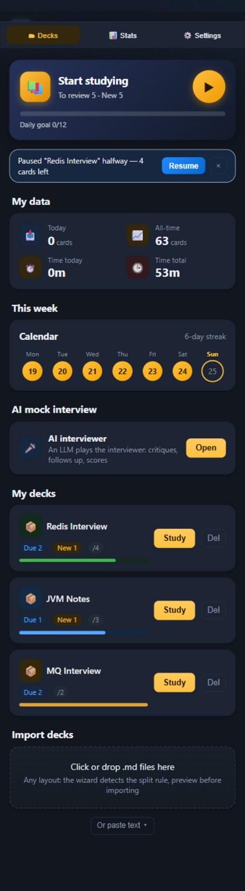
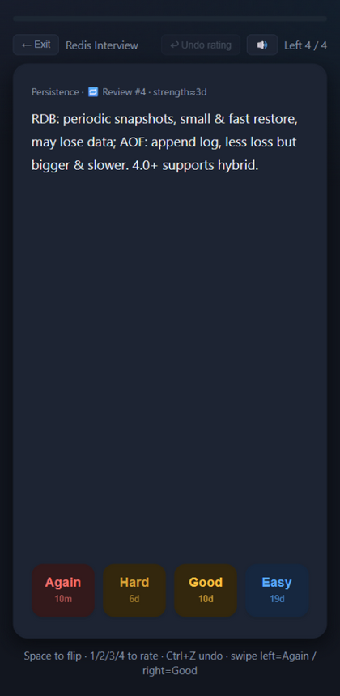
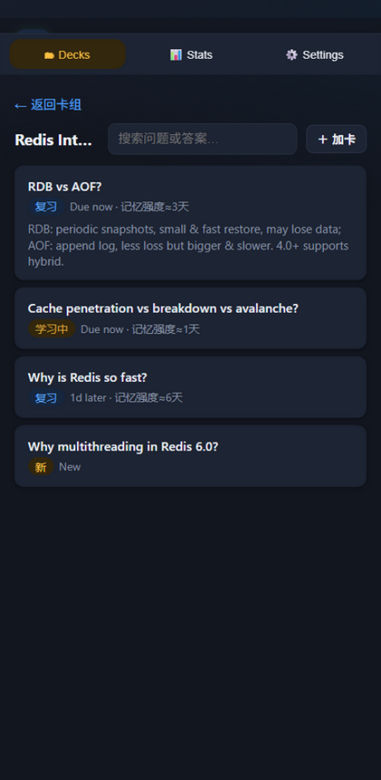
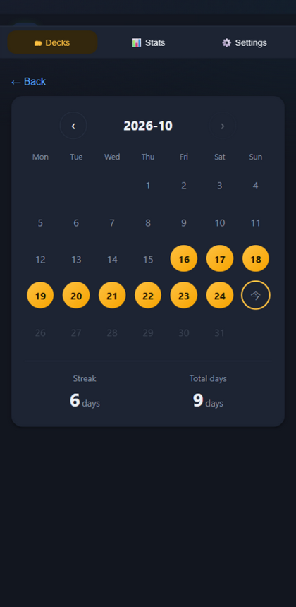
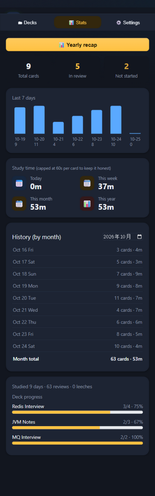
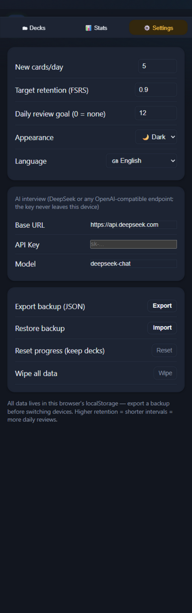

<div align="center">


# ByeByeBaGu · 不背八股

**Turn your own Markdown interview notes into word-app-style flashcard review**

*Import → spaced repetition → AI mock interviewer. All in a single HTML file.*

[](https://nina-noschool.github.io/ByeByeBaGu/)
[](八股闪背.html)
[](deploy/一键安装指南.md)

[](LICENSE)
[](#-features)
[](八股闪背.html)
[](#-features)
[](deploy/一键安装指南.md)
[](https://github.com/nina-noschool/ByeByeBaGu/pulls)

English | [简体中文](README.md)

</div>

---

## Why it exists

The biggest pain of preparing for technical interviews: **you read it, you forget it, and in the interview you can't say it out loud**.
ByeByeBaGu ("bye-bye, rote answers") slices your interview notes into flashcards, uses the FSRS spaced-repetition
algorithm to schedule reviews right before you forget, then has an LLM play the interviewer and **grill you on the spot** —
because knowing it isn't enough; you have to be able to say it.

> Built primarily for Chinese tech-interview prep (八股文 / 面经). The UI now supports English too — switch in Settings.

<div align="center">
<table>
  <tr>
    <td align="center"><br><sub>Home · goals & stats</sub></td>
    <td align="center"><br><sub>Immersive review · 4-button rating</sub></td>
    <td align="center"><br><sub>Deck browser · edit & search</sub></td>
  </tr>
  <tr>
    <td align="center"><br><sub>Study calendar</sub></td>
    <td align="center"><br><sub>Time stats · yearly recap</sub></td>
    <td align="center"><br><sub>Settings · appearance & AI</sub></td>
  </tr>
</table>
<sub>Screenshots are from the real v1.17 UI in English</sub>
</div>

## ✨ Features

**🌐 Bilingual UI (Chinese / English)**
One tap in Settings to switch between 中文 and English (or follow your browser). Dates, intervals,
durations, the calendar and stats are all localized — and the AI interviewer asks and critiques in
English when the UI is English.

**📥 Import any layout**
Drop in a `.md` file (or **paste text directly**) — the import wizard auto-detects how to split it
(heading levels / Q&A pairs / list items / inline cards), with previews, strategy switching,
empty/overlong-answer diagnostics and one-click undo. Dedup uses a **semantic key**: reformatting your
notes and re-importing creates no duplicates and never resets progress. Parser rules: [import spec](docs/import-spec.md).

**🎤 AI interviewer (three intensity levels)**
Connects to DeepSeek (any OpenAI-compatible endpoint) and grills you question by question:
**correctness/depth/clarity** three-dimension critique against the reference → dynamic follow-ups
(strong answer gets a counterfactual; stuck means a proper explanation, not humiliation) → score →
a **weak-spot recap with an action list** at the end. Intensity: 😊 Gentle / 😎 Standard / 😈 Hell (stress interview).

**🗂 Deck housekeeping**
Multi-select cards inside a deck and **move them to another deck / delete in bulk** — combine multiple
question banks without the mess.

**🧠 FSRS spaced repetition**
Ports the latest FSRS formulas from [ts-fsrs](https://github.com/open-spaced-repetition/ts-fsrs),
with a tunable target retention (default 0.9) and live memory-strength/next-interval display per card.

**🎯 Weak-card priority & session resume**
Queue building scores each card on its **last 10 ratings**; weak cards appear 2–3× per session (never adjacent).
Exit, refresh or kill the app mid-session — the home screen offers a one-click "continue" from where you left off.

**🃏 A serious review experience**
Space to flip, 4-button rating (Again/Hard/Good/Easy, each showing the next interval), undo (Ctrl+Z),
🔊 text-to-speech for hands-free recall, auto-flag leech cards 🔥 after 5 consecutive lapses,
cloze cards (`==highlight==`, tap to reveal), and markdown **images in answers** (architecture diagrams welcome).

**📊 Stats you'll actually look at**
Daily goal & study calendar, daily/weekly/monthly/yearly time tracking, per-month history —
and a **yearly recap** card (reviews, study days, mastered, most-studied deck).

**📱 Feels like a real app**
Installable PWA (phone home screen / desktop), fully offline; immersive mobile study view,
swipe-to-rate, bottom tab navigation.

**🔒 Your data stays yours**
Everything lives in your browser's localStorage. Nothing is uploaded. JSON backup & restore included.

## 🚀 Quick start

| Option | How |
|---|---|
| **Use online** (recommended) | Open [https://nina-noschool.github.io/ByeByeBaGu/](https://nina-noschool.github.io/ByeByeBaGu/) → add to home screen. See the [install guide](deploy/一键安装指南.md) (Chinese) |
| **Deploy your own** | Fork this repo → enable GitHub Pages → see the [install guide](deploy/一键安装指南.md); update via Sync fork |
| **Run locally** | Download [`八股闪背.html`](八股闪背.html), double-click it. Zero install |

## 📖 Import formats

The wizard auto-detects the best strategy, which you can also set manually:

| Strategy | Source shape | Notes |
|---|---|---|
| Headings | `## Question` + body / `### Question` + body | Most common for interview notes; heading level auto-detected |
| Q&A pairs | `问：…` / `答：…` or `Q:` / `A:` | Tolerates `**问：**`, `【问题】` variants |
| List items | `- Question: one-line answer` | One card per line |
| Inline cards | `Question :: Answer` | Syntax from obsidian-spaced-repetition |

Fenced code blocks and inline code never get split on `#`, `---`, `==` or `::`.
[Sample files](samples/) for all four shapes are in `tests/` — drop one into the wizard to try it.

Already have an **Anki deck (.apkg)**? Convert it with the dev-time tool (the app itself stays zero-dependency):

```
cd tools && npm install
node apkg2md.js your-deck.apkg deck.md
```

<details>
<summary><b>🤖 Let an AI write your cards</b> (click to expand)</summary>

- **In-app**: the **🤖 AI generate** button next to the paste box turns any pasted notes into Q&A cards;
- **Outside the app**: feed the [import spec](docs/import-spec.md) to any AI (ChatGPT / Claude / Cursor…) and ask it
  to convert your notes, ending the prompt with:
  > The output must strictly follow the "heading split" strategy in the spec above: one `## Question` line per card, followed by its answer body.

</details>

## 🤖 AI interviewer setup

1. Create an API key at [platform.deepseek.com](https://platform.deepseek.com) (a full mock interview costs a few cents)
2. In the app: Settings → AI interview → paste your key (base URL and model pre-filled as `deepseek-chat`)
3. Home → "AI interviewer" → pick a deck → start

The key is stored only in your browser's localStorage. It never leaves your machine except to call the AI provider you configured.

## 🐦 Mascot · ByteBit

A chibi myna bird wearing headphones ("八比特", a pun on 八股), the project's one and only official IP:

<p align="center"></p>

Design record & usage rules: [docs/bytebit.md](docs/bytebit.md).
It shows up on the splash, in the AI interviewer's "thinking" state, in the goal celebration and the yearly recap — the app icon is its face.

## 🗺 Roadmap

- [x] FSRS scheduling, import wizard, cloze cards, AI interviewer, time tracking, PWA, weak-card priority, session resume, yearly recap
- [ ] Anki `.apkg` import (validating under the zero-dependency constraint)
- [ ] IndexedDB storage for 10k+ card libraries
- [ ] Two-pane tablet/desktop layout
- [ ] More ByteBit poses & empty-state illustrations

PRs welcome — when touching the parser, please update the [import spec](docs/import-spec.md) first and include tests.

## 🧑‍💻 Development

Zero dependencies, zero build step — editing [`八股闪背.html`](八股闪背.html) *is* editing the whole app:

```
node tests/test-parser.js   # markdown parsing & split strategies
node tests/test-fsrs.js     # FSRS scheduling invariants
node tests/test-cloze.js    # cloze card rendering
node tests/test-queue.js    # weak-card priority queue
node tests/test-dedup.js    # semantic dedup
node tests/test-i18n.js     # English dictionary completeness
```

```
├── 八股闪背.html       # the app itself (single file)
├── index.html          # Pages entry (kept in sync)
├── manifest.webmanifest / sw.js / icon.svg
├── deploy/             # install guide & deployment kit
├── docs/               # mascot record · import spec · screenshots
├── samples/            # sample md files for the four shapes
└── tests/              # 56 pure-function tests
```

## 🙏 Acknowledgements

Design & implementation drew on these open-source projects; details in [THIRD_PARTY_NOTICES.md](THIRD_PARTY_NOTICES.md):

- [open-spaced-repetition/ts-fsrs](https://github.com/open-spaced-repetition/ts-fsrs) (MIT) — FSRS formulas & parameters
- [st3v3nmw/obsidian-spaced-repetition](https://github.com/st3v3nmw/obsidian-spaced-repetition) (MIT) — inline-card & cloze syntax, fence handling
- [L-M-Sherlock/markdown2anki](https://github.com/L-M-Sherlock/markdown2anki) (MIT) — heading-level normalization
- [ObsidianToAnki/Obsidian_to_Anki](https://github.com/ObsidianToAnki/Obsidian_to_Anki) · [e-chehil/anki-quizify](https://github.com/e-chehil/anki-quizify) — import-wizard ideas (no code reused)
- [wangPing2002/SocialWork-Flashcards](https://github.com/wangPing2002/SocialWork-Flashcards) — session resume & weak-card queue design (no code reused)
- [jvsena42/loopky](https://github.com/jvsena42/loopky) — paste import, read-aloud & recap ideas (no code reused)
- [shaankhosla/repeater](https://github.com/shaankhosla/repeater) · [felixborretti/hashcards](https://github.com/felixborretti/hashcards) — semantic dedup & LLM-helper ideas (no code reused)

## 📄 License

[MIT](LICENSE) © 2026 nina-noschool

<div align="center">
<sub>Made with ❤️ and one HTML file · If it helps you, a ⭐ helps other interviewees find it</sub>
</div>

---

<!-- ===== MAINTENANCE RULES =====
   The top of this README always describes the current state: when a feature changes, update the
   matching section — never leave stale descriptions. Version history lives only in the "Changelog"
   section at the bottom, appended in reverse order; do not open separate CHANGELOG files.
   ========================================== -->

## 🗂 Changelog

### v1.18.0 (2026-10-27)
- 🎤 AI interviewer v2 (methodology borrowed from the asu-skills/interview skill): three intensity levels
  (Gentle / Standard / Hell stress interview), dynamic follow-up stop conditions (solid → counterfactual;
  partial → key gap only; lost → explain and move on), weakness-signal grilling (vague words, unexplained
  metrics, happy-path-only answers), three-dimension critiques, weak-spot recap
- 🗂 Deck housekeeping: multi-select cards, bulk move to another deck / bulk delete
- 🧰 Dev-time tool `tools/apkg2md.js`: Anki .apkg → this format's markdown (both legacy & new Anki schemas,
  cloze auto-converted to ==syntax==; tested against a real 373-card deck)
- ⚡ 300ms debounce on the answer-path save() + flush on page hide (merged high-frequency writes)
- 🤖 CI: GitHub Actions keeps index.html in sync with the app source automatically
- 🧪 New `tests/test-i18n.js`: hard validation of the English dictionary (fixed 31 missing translations,
  removed 54 stale keys this round)

### v1.17.0 (2026-10-25)
- Bilingual UI: dictionary-based i18n (~190 strings), new "Language" setting (中文 / English / follow browser)
- Localized formatting: intervals (1d/3mo/1.2y), durations (45m/1h 20m), calendar (Mon~Sun), stat dates (Oct 24 Fri)
- AI interviewer prompt follows the UI language (asks/critiques in English when the UI is English)
- Verified view-by-view in a browser: zero visible Chinese left in English mode

### v1.16.1 (2026-10-25)
- New brand icon: the ByteBit face (navy tile, green headphones, ivory beak), matching the in-app splash;
  replaces icon.svg / top-bar logo / PWA theme colors
- The GitHub About social preview must be re-uploaded manually in repo settings

### v1.16.0 (2026-10-25)
- Semantic dedup hashing: markdown markers/punctuation/whitespace are stripped before hashing — reformatting
  notes no longer creates duplicates or resets progress (idea from repeater/hashcards)
- 🤖 AI generate: turn pasted notes into Q&A cards via LLM, straight into the import wizard
- Markdown image rendering in answers (http/https/data:image, sanitized)
- New `tests/test-dedup.js` (8 tests)

### v1.15.0 (2026-10-25)
- UI 7.0 enterprise polish: CJK font stack & antialiasing, tabular numerals, brand focus rings on all
  interactive elements, card-style toasts, mascot empty states, slim scrollbars, transition suppression on
  theme switch, prefers-reduced-motion support
- Aligned with the better-ui checklist: 0.96/150ms press scale (disabled excluded), `cubic-bezier(.2,0,0,1)`,
  no `transition:all`, hover lifts disabled on touch, scroll containment in the AI chat

### v1.14.0 (2026-10-25)
- Paste-to-import sharing the same wizard pipeline (idea from Loopky)
- 🔊 Read-aloud via the browser's built-in speech synthesis (idea from Loopky)
- Yearly recap card (idea from Loopky's Recap)
- New [docs/import-spec.md](docs/import-spec.md): the formal parser spec the tests are written against

### v1.13.0 (2026-10-25)
- Session resume: a "continue" banner on the home screen after exiting/refreshing mid-session
- Weak-card priority queue based on the last 10 ratings (idea from SocialWork-Flashcards)
- Settings split "reset progress (keep decks)" from "wipe everything"
- New `tests/test-queue.js` (12 tests)

### v1.12.0 and earlier
See the [Chinese README](README.md), [docs/bytebit.md](docs/bytebit.md) (mascot record) and the git history.
